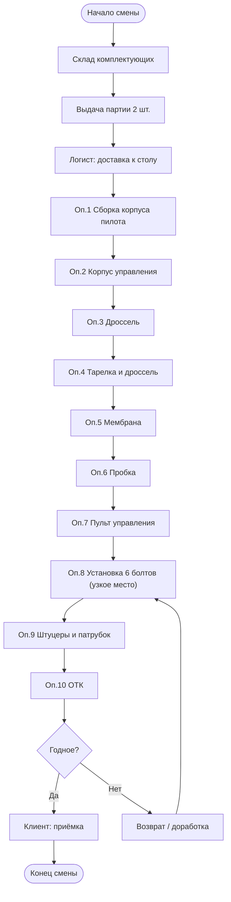
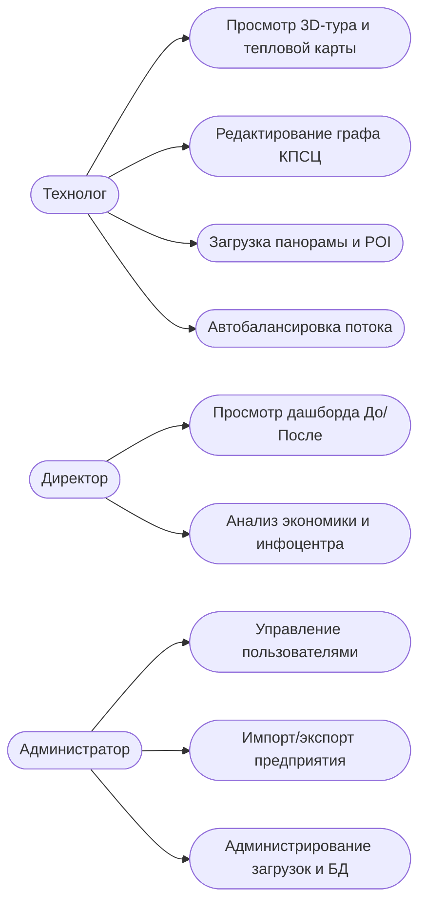
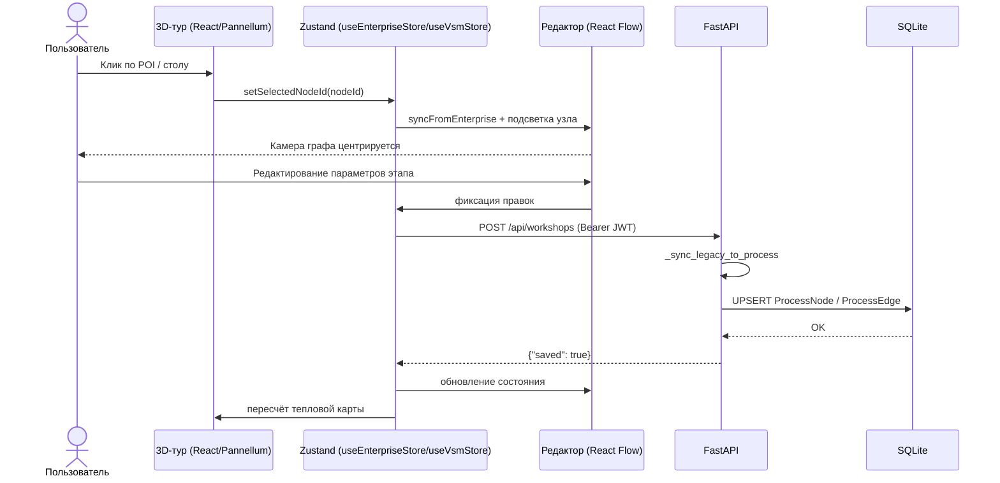
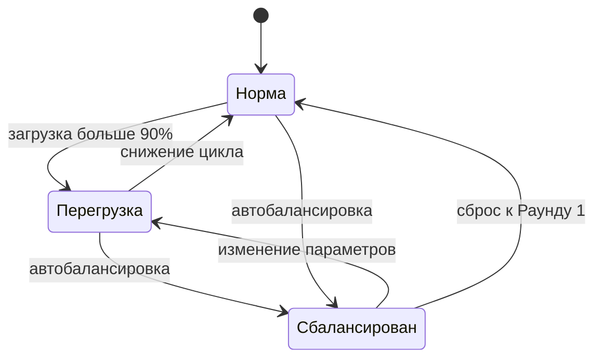
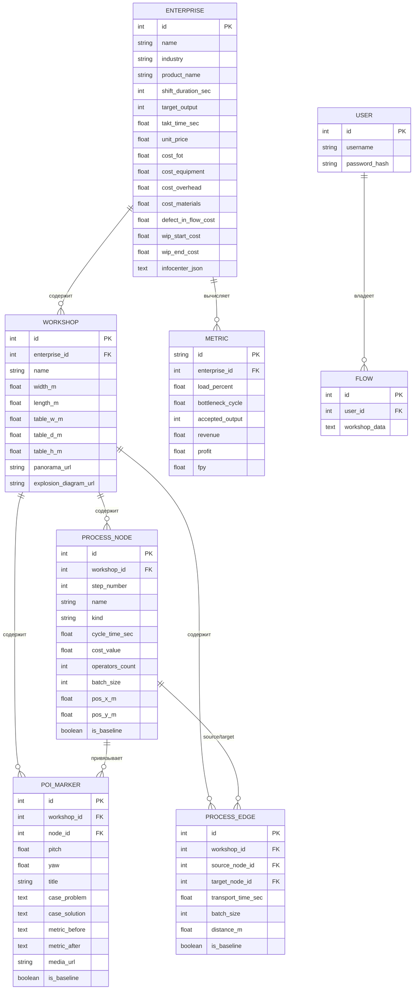
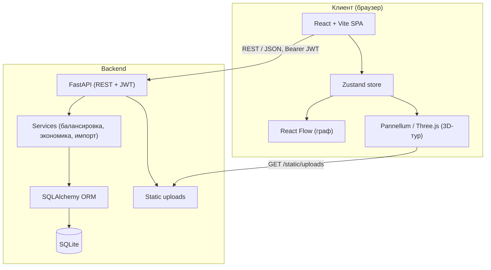

# Техническое задание
## на разработку программного продукта «Kataxone — цифровой двойник производственного потока (КПСЦ) и 3D-тур предприятия»

| Параметр | Значение |
|---|---|
| Наименование продукта | Kataxone |
| Класс системы | Web-приложение (SPA) + REST API |
| Редакция | MVP, v2.0.0 |
| Технологический стек | Frontend: React, Vite, Zustand, React Flow, Three.js (react-three-fiber), Pannellum · Backend: Python, FastAPI, SQLAlchemy, SQLite |
| Пилотный кейс | «Фабрика процессов РЦК Башкортостан» — сборка регулятора давления газа VENIO-C |

---

## 1. Введение

### 1.1. Цель
Создание интерактивной платформы «Kataxone» для построения цифрового двойника производственного потока создания ценности (КПСЦ). Продукт объединяет 3D-визуализацию цеха, редактор графа технологического процесса и аналитический дашборд, позволяя выявлять узкие места, симулировать улучшения и оценивать экономический эффект в реальном времени.

### 1.2. Задачи
1. Оцифровать реальный производственный кейс «Фабрика процессов РЦК Башкортостан» (сборка пульта управления регулятора давления газа VENIO-C).
2. Реализовать 3D-тур цеха с тепловой картой загрузки и точками интереса (POI).
3. Реализовать интерактивный редактор графа КПСЦ с двусторонней синхронизацией с 3D-туром.
4. Реализовать аналитический дашборд «До/После» с инфоцентром и диаграммой Ямадзуми.
5. Реализовать алгоритм автобалансировки потока, снижающий перегрузку узкого места.
6. Обеспечить загрузку пользовательских 360°-панорам и базовую авторизацию (JWT, ФЗ-152).

### 1.3. Контекст
Продукт разрабатывается для хакатона «Цифровой двойник предприятия и 3D-туры». Ключевая проблема пилотного кейса — **Оператор №8** («Установка 6 болтов в пульт управления»): время цикла **171 сек** при такте **120 сек**, перегрузка **142,5%**. Это ограничивает выпуск и формирует отрицательную экономику Раунда 1.

### 1.4. Ограничения
- Отсутствует интеграция с учётными системами 1С / ERP / MES — данные о смене и затратах задаются вручную либо импортируются в JSON.
- В MVP используются синтетические (учебные) данные пилотного кейса; коннекторы к реальным источникам данных не входят в объём.
- Хранилище — встраиваемая SQLite (однопользовательский/демо-режим), без распределённой БД и горизонтального масштабирования.
- Аутентификация базовая (логин/пароль + JWT), без ролевой модели и SSO.

## 2. Системный анализ предметной области

### 2.1. Мнемосхема бизнес-процесса
Процесс «Сборка VENIO-C» представляет собой последовательную цепочку из 10 рабочих мест, развёрнутую от зоны «Склад комплектующих» до зоны «Клиент» (приёмка). Материальный поток обслуживает логист, который доставляет комплектующие со склада партиями по 2 шт. по заявкам операторов.

```mermaid
flowchart LR
    S["Склад<br/>(3.0, 17.5)"] --> L["Логист: рейсы<br/>15+15+20+15+15+10+20+15+15 сек"]
    L --> O1["Оп.1 · 81 с"]
    O1 --> O2["Оп.2 · 66 с"]
    O2 --> O3["Оп.3 · 13 с"]
    O3 --> O4["Оп.4 · 61 с"]
    O4 --> O5["Оп.5 · 35 с"]
    O5 --> O6["Оп.6 · 39 с"]
    O6 --> O7["Оп.7 · 102 с"]
    O7 --> O8["Оп.8 · 171 с ⚠ 142.5%"]
    O8 --> O9["Оп.9 · 82 с"]
    O9 --> O10["Оп.10 ОТК · 22 с"]
    O10 --> C["Клиент<br/>(1.8, 1.5)"]
```

### 2.2. Таблица рабочих мест (Раунд 1 — «Как есть»)

| № | Этап | Цикл, с | Загрузка, % | Статус |
|---|---|---|---|---|
| 1 | Сборка корпуса пилота и крышки нижней | 81 | 67,5 | норма |
| 2 | Сборка корпуса управления и крышки верхней | 66 | 55,0 | норма |
| 3 | Сборка дросселя | 13 | 10,8 | недозагрузка |
| 4 | Установка тарелки и дросселя | 61 | 50,8 | норма |
| 5 | Сборка мембраны | 35 | 29,2 | недозагрузка |
| 6 | Сборка пробки | 39 | 32,5 | недозагрузка |
| 7 | Сборка пульта управления | 102 | 85,0 | предкритическая |
| **8** | **Установка 6 болтов в пульт** | **171** | **142,5** | **узкое место** |
| 9 | Установка штуцеров и патрубка | 82 | 68,3 | норма |
| 10 | Контрольная операция (ОТК) | 22 | 18,3 | недозагрузка |

### 2.3. Экономика Раунда 1
- Такт: `1200 с / 10 шт = 120 с`. Узкое место `171 с` ограничивает теоретический выпуск `floor(1200/171) = 7 шт`.
- С учётом брака в потоке клиенту сдаётся **2 шт** (FPY 33%). Выручка `2 × 70 000 = 140 000 ₽`.
- Итоговые затраты смены: `160к + 153к + 200к + 60к = 573 000 ₽`; себестоимость 1 ед. `286 500 ₽`; прибыль `−433 000 ₽` (с браком `−473 000 ₽`).
- **Вывод:** устранение перегрузки Оп. №8 — ключевой рычаг роста выпуска и выхода в прибыль.

## 3. Требования

### 3.1. Функциональные требования

#### ФР-1. 3D-тур
- ФР-1.1. Отображение панорамы цеха (Pannellum) с точками интереса (POI), пульсирующими метками и списком этапов.
- ФР-1.2. Навигация: осмотр перетаскиванием мыши, масштаб колесом, плавный поворот камеры к выбранному POI.
- ФР-1.3. Тепловая карта загрузки столов: `>100%` — пульсирующий красный (критично), `>90%` — красный, `85–90%` — янтарный, `50–85%` — зелёный, `<50%` — голубой.
- ФР-1.4. Карточка «рентген рабочего места»: время цикла, комплектующие, оснастка, лишние предметы (5S), схема узла, кнопка «Перейти к этапу в Редакторе КПСЦ».
- ФР-1.5. Переключение раундов «До/После» с перестройкой столов в U-образную ячейку и сокращением маршрута логиста.

#### ФР-2. Редактор графа КПСЦ
- ФР-2.1. Редактирование графа на React Flow: перетаскивание, добавление/удаление узлов, создание связей.
- ФР-2.2. Редактирование параметров этапа: название, время цикла, загрузка, стоимость.
- ФР-2.3. Сохранение графа на сервер (`POST /api/workshops`) и сброс к исходному состоянию.
- ФР-2.4. Двусторонняя синхронизация с 3D-туром: из тура — подсветка узла на графе; из редактора — фокусировка камеры тура.

#### ФР-3. Дашборд «До/После»
- ФР-3.1. 5-цветный инфоцентр РЦК: Безопасность, Качество (FPY), Поток и Такт, Затраты, НЗП/Запасы.
- ФР-3.2. Диаграмма Ямадзуми загрузки операторов с линией такта.
- ФР-3.3. Калькулятор экономики: такт, узкое место, выпуск, выручка, себестоимость, прибыль.
- ФР-3.4. Экспорт плана улучшений.

#### ФР-4. Автобалансировка потока
- ФР-4.1. Кнопка «Автобалансировка потока» в один клик.
- ФР-4.2. Алгоритм переносит избыточное время узкого места на соседние (по близости номера этапа) столы без превышения потолка загрузки; суммарное время сохраняется.
- ФР-4.3. Снижение пиковой загрузки со 142,5% до ≤ 90% (целевое значение 80%, потолок 96%; в пилоте новое узкое место — Оп. №7, 102 с ≈ 85%).
- ФР-4.4. Протокол перераспределения операций и сброс к Раунду 1.

#### ФР-5. Прочее
- ФР-5.1. Загрузка 360°-панорам и изображений (`/api/upload/panorama`, `/api/upload`, лимит 25 МБ).
- ФР-5.2. Авторизация: регистрация, вход, JWT-токен, согласие на обработку ПДн (ФЗ-152).
- ФР-5.3. Мультипроектность: список предприятий, создание, импорт/экспорт JSON.

### 3.2. Нефункциональные требования

| № | Категория | Требование |
|---|---|---|
| НФ-1 | Адаптивность | Корректное отображение на десктопе и планшете; адаптивная сетка дашборда |
| НФ-2 | Производительность | Время отклика REST API и пересчёта метрик < 1 с |
| НФ-3 | Графика | Рендеринг 3D-тура через WebGL; плавная анимация (≥ 30 FPS на целевых устройствах) |
| НФ-4 | Защита данных | Хэширование паролей (bcrypt), JWT (HS256), согласие ФЗ-152, CORS-ограничение |
| НФ-5 | Надёжность | Автосид пилота при старте; офлайн-fallback на локальные данные |
| НФ-6 | Масштабируемость | Мультипроектная модель данных (много предприятий/цехов) |

## 4. Модели и диаграммы

### 4.1. Activity Diagram (процесс сборки)

### 4.2. UML Use Case Diagram

### 4.3. UML Sequence Diagram (Клик в 3D → Zustand → Граф → БД)

### 4.4. UML State Machine (статусы узла)

### 4.5. ER-диаграмма БД

> Примечание: сущность `METRIC` — вычисляемая (проекция) и материализуется в ответах API; в текущей реализации метрики рассчитываются «на лету» и не хранятся отдельной таблицей.

## 5. Архитектура системы

### 5.1. Компоненты

### 5.2. REST API (основные интерфейсы)

| Метод | Эндпоинт | Назначение |
|---|---|---|
| POST | `/api/register` | Регистрация пользователя |
| POST | `/api/login` | Вход, выдача JWT |
| GET/POST | `/api/enterprises` | Список / создание предприятия |
| GET/PUT/DELETE | `/api/enterprises/{id}` | Чтение / изменение / удаление |
| GET | `/api/enterprises/{id}/dashboard` | Сводка дашборда «До/После» |
| GET | `/api/enterprises/{id}/infocenter` | Данные инфоцентра |
| POST | `/api/enterprises/{id}/autobalance` | Предпросмотр автобалансировки |
| GET | `/api/enterprises/{id}/export` | Экспорт JSON |
| POST | `/api/enterprises/import` | Импорт JSON |
| GET/POST | `/api/workshops` | Legacy-сохранение графа КПСЦ |
| GET/POST | `/api/workshops/{id}/nodes` | Чтение / создание этапов |
| GET/POST | `/api/workshops/{id}/edges` | Чтение / создание связей |
| GET/POST | `/api/workshops/{id}/pois` | Чтение / создание POI |
| POST | `/api/upload/panorama` | Загрузка 360°-панорамы |
| POST | `/api/upload` | Загрузка изображений |
| GET | `/api/health` | Статус сервиса |

### 5.3. Потоки данных
1. **Загрузка:** клиент получает список предприятий (`GET /api/enterprises`), затем полный объект (`GET /api/enterprises/{id}`) со вложенными цехами, узлами, связями и POI; данные декорируются (пересчёт такта и загрузки) и попадают в Zustand.
2. **3D → Граф:** клик по POI записывает `nodeId` в общий стор; редактор при открытии центрирует граф на узле.
3. **Граф → 3D:** кнопка «Показать в 3D» записывает `nodeId`, тур фокусирует камеру на соответствующем POI.
4. **Сохранение:** правки графа отправляются в `POST /api/workshops`; сервер синхронизирует их в таблицы `process_nodes`/`process_edges`.
5. **Балансировка:** `POST /api/enterprises/{id}/autobalance` возвращает план перераспределения; фронтенд применяет его и пересчитывает дашборд.

## 6. Визуальные макеты (описание UI)

### 6.1. Экран «Дашборд До/После»
- **Шапка:** заголовок «Цифровой Инфоцентр РЦК», название предприятия, строка «Смена 1200 с · План 10 шт · Такт 120 с · Раунд».
- **Инфоцентр (5 цветных колонок):** Безопасность (0 инцидентов), Качество (FPY %), Поток и Такт (узкое место), Затраты (итого ₽/смену), НЗП/Запасы (динамика). Каждая колонка имеет акцентный цвет.
- **Диаграмма Ямадзуми:** столбцы загрузки 10 операторов с красной пунктирной линией такта; перегруженные столбцы подсвечены, недозагруженные — синим.
- **Панель действий:** кнопки «Автобалансировка потока» / «Сбросить к исходному», «Проверить в 3D-цехе».
- **Протокол перераспределения:** список «Оператор №N → Оператор №M: X сек».

### 6.2. Экран «3D-тур»
- **Основная область:** панорама цеха; слева — панель со списком POI (этапы).
- **Метки:** пульсирующие точки интереса в панораме; клик плавно поворачивает камеру.
- **Тепловая карта:** столы окрашены по загрузке (критично/перегруз/предел/оптимум/недозагрузка).
- **Карточка POI:** название, загрузка, время цикла; кнопка перехода в редактор.
- **Переключатель цехов/раундов:** «Перейти в Цех 2 / Вернуться в Цех 1», режим 3D/360°.

## 7. План тестирования

### 7.1. Тест-кейс «Загрузка панорамы»

| Поле | Значение |
|---|---|
| ID | TC-01 |
| Предусловие | Авторизация пройдена, сервис запущен |
| Шаги | 1. Открыть мастер загрузки. 2. Выбрать файл `panorama.jpg` (≤ 25 МБ). 3. Отправить на `/api/upload/panorama` |
| Ожидание | HTTP 201/200, в ответе `url` вида `/static/uploads/<uuid>.jpg`; панорама отображается в 3D-туре |
| Негатив | Файл `.exe` или > 25 МБ → HTTP 400 с сообщением об ошибке |

### 7.2. Тест-кейс «Автобалансировка»

| Поле | Значение |
|---|---|
| ID | TC-02 |
| Предусловие | Загружен пилот VENIO-C, узкое место Оп. №8 = 171 с (142,5%) |
| Шаги | 1. Открыть Дашборд. 2. Нажать «Автобалансировка потока» |
| Ожидание | `new_bottleneck_cycle_sec ≤ 120 с`; загрузка Оп. №8 ≤ 90%; протокол перераспределения заполнен; выпуск и прибыль пересчитаны |
| Негатив | Повторное нажатие не дублирует эффект; «Сбросить» возвращает Раунд 1 |

### 7.3. Тест-кейс «Сохранение графа»

| Поле | Значение |
|---|---|
| ID | TC-03 |
| Предусловие | Авторизация, открыт редактор КПСЦ |
| Шаги | 1. Изменить время цикла этапа. 2. Добавить/удалить узел. 3. Нажать «Сохранить на сервер» |
| Ожидание | `POST /api/workshops` → `{"saved": true}`; изменения отражены в БД (`process_nodes`), дашборде и 3D-туре |
| Негатив | Без JWT → HTTP 401; невалидный JSON → 4xx |

### 7.4. Тест-кейс «Двусторонняя синхронизация»

| Поле | Значение |
|---|---|
| ID | TC-04 |
| Шаги | 1. Клик по POI в 3D-туре → открыть редактор (узел подсвечен). 2. В редакторе нажать «Показать в 3D» → камера тура наводится на этап |
| Ожидание | Один и тот же `nodeId` используется в обоих направлениях; состояние согласовано |

---

## 8. Критерии приёмки и оценки (сводно)

- **Инновационность:** гибрид 3D-тура и графа КПСЦ с тепловой картой и «цифровым инфоцентром».
- **Техническое исполнение:** SPA (React/Vite) + REST (FastAPI) + SQLite; двусторонняя синхронизация через единое состояние Zustand.
- **Применимость:** реальный кейс РЦК, экономический расчёт и план улучшений.
- **Документация:** настоящее ТЗ, README, USER_GUIDE, SPEC.
- **UI:** адаптивный дашборд, интерактивный 3D-тур, диаграмма Ямадзуми.
- **Алгоритмы:** расчёт такта/загрузки, поиск узкого места, автобалансировка, маршруты логиста.
- **Командная работа / презентация / адаптивность:** MVP готов к демонстрации и масштабированию на другие предприятия.

